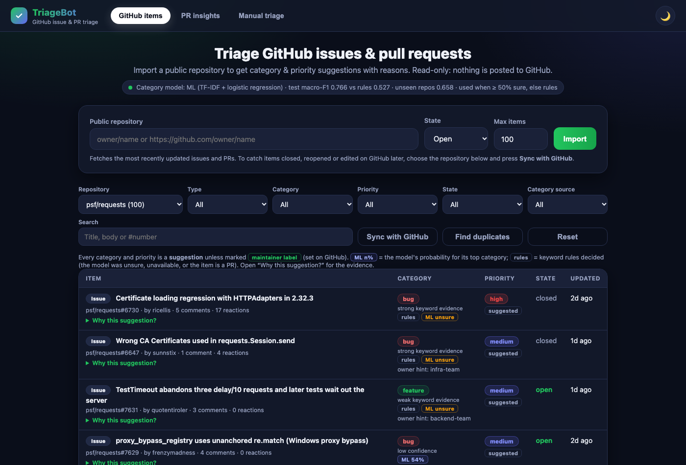
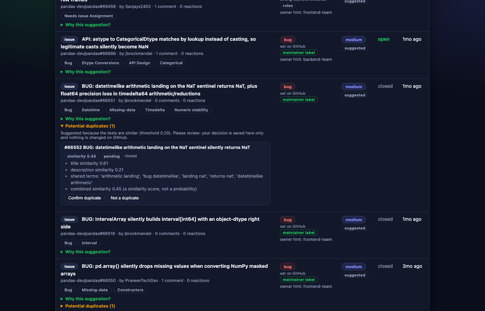
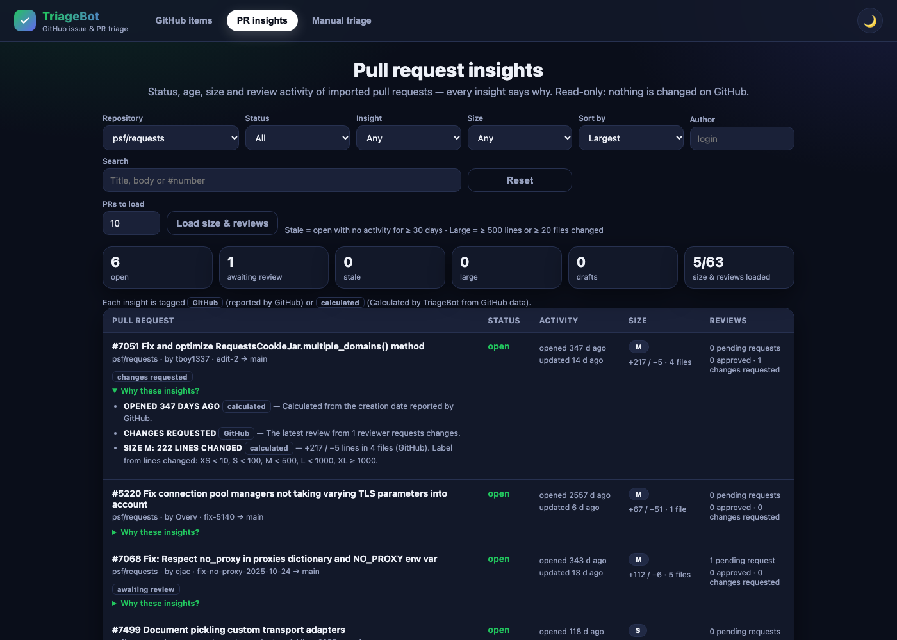
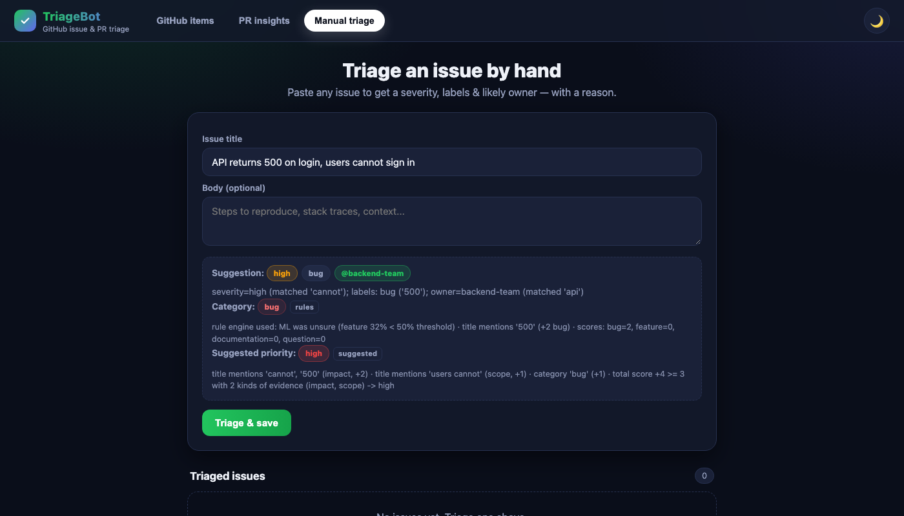

# TriageBot

> A GitHub issue & pull-request triage dashboard. Import a public repository and
> TriageBot suggests a **category** (bug / feature / documentation / question)
> and a **priority** (low / medium / high) for every item — with a
> human-readable explanation of every point that led to the suggestion.

TriageBot is **read-only**: it only ever sends `GET` requests to GitHub and never
posts, labels, or comments. Issue categories come from a small local
**machine-learning model** (TF-IDF + logistic regression, scikit-learn) with the
keyword rule engine as a fallback; priority comes from an explainable,
deterministic scorer that keeps maintainers' own priority labels. It runs
offline with **no paid AI services**, and every suggestion shows where it came
from and why.

**Status:** a working local application with a 543-test suite, run on
Python 3.11 and 3.14. It is **not deployed**: there is no public URL. It is
also **not production-ready**: there are no user accounts, no
authentication and no rate limiting (see
[Security and limitations](#limitations)). The verification commands and
limitations are documented in [Testing & verification](#testing--verification).

## Screenshots

These are real captures of the local app (2026-10-03, after Phase 6). They
show `psf/requests`, imported live, and a sample of `pandas-dev/pandas`
issues: locally cached, then brought up to date with a live sync.

| Imported items with category & priority                   | Duplicate review                                                        |
| --------------------------------------------------------- | ----------------------------------------------------------------------- |
|  |  |
| **PR insights**                                           | **Manual triage**                                                       |
|    |              |

A mobile layout is also captured at 390 px:
[`docs/screenshots/05-mobile.png`](docs/screenshots/05-mobile.png).

## Tech stack

| Layer           | Technology                                                                                                    |
| --------------- | ------------------------------------------------------------------------------------------------------------- |
| API             | Python, FastAPI 0.115.6, Pydantic 2, Uvicorn 0.34.0                                                           |
| GitHub access   | httpx 0.28.1 (read-only REST client, `GET` requests only)                                                     |
| Storage         | SQLite through the standard-library `sqlite3`, with numbered migrations (`PRAGMA user_version`, currently v7) |
| ML / similarity | scikit-learn 1.9.1: TF-IDF, logistic regression and cosine similarity; NumPy arrays saved without pickle      |
| Frontend        | A single `static/index.html` with vanilla JavaScript and CSS, served by FastAPI, with no build step           |
| Quality         | pytest 8.3.4, ruff 0.8.6, and a GitHub Actions workflow for Python 3.11–3.13                                  |

## Features

- **Import from GitHub** — issues _and_ PRs from any public repository
  (`owner/name` or a GitHub URL), with pagination, an item limit, and an
  open / closed / all filter. Re-importing refreshes items instead of
  duplicating them.
- **Sync with GitHub** — one click (or `POST /repos/sync`) fetches every issue
  and PR changed on GitHub since the last sync, open _or_ closed, so items
  closed or reopened upstream change state locally too. See
  [Keeping data current](#keeping-imported-data-current-sync).
- **ML issue classification** — a TF-IDF + logistic-regression model trained
  on 2,964 maintainer-labelled GitHub issues predicts bug / feature /
  documentation / question with a probability and the words that drove it.
  Low-confidence predictions, pull requests, and a missing model fall back to
  the rule engine. [Evaluation results](#evaluation-results) are measured, not
  estimated.
- **Explainable priority** — low / medium / high from a transparent, deterministic
  scorer. A maintainer's explicit priority label (`P1`, `priority: high`, …) is
  kept as-is; otherwise "high" needs two different kinds of evidence, so a single
  keyword or popularity alone never makes an item high. See
  [Priority scoring](#priority-scoring).
- **Explainable suggestions** — category, confidence, source (ML / rules /
  maintainer label), priority and its source, and an optional owner hint, each backed by
  reasons such as `words pointing to bug: 'traceback' (+0.31)` or
  `title mentions 'crash' (impact, +2)`.
- **Whole-word matching with negation** — `auth` does not match "author",
  `500` does not match "1500ms", and "not urgent" does not count as urgent.
- **Duplicate detection** — after each import, similar issues in the same
  repository are suggested as _possible_ duplicates (TF-IDF + cosine
  similarity on titles and descriptions), with a similarity score and the
  shared terms. Maintainers confirm or reject each suggestion in the dashboard;
  nothing is ever closed or changed on GitHub. See
  [Duplicate detection](#duplicate-detection).
- **PR insights** — a dedicated view of imported pull requests: status (open,
  draft, merged, closed), age, time since last update, size (lines and files),
  pending review requests and review states, with stale / awaiting review /
  large flags. Every insight states whether GitHub reported it or TriageBot
  calculated it, and why. See [PR insights](#pr-insights).
- **Filterable dashboard** — filter by repository, type, category, priority,
  state and category source, search titles / bodies / `#numbers`, and page
  through results. A status line shows whether the ML model is loaded and its
  recorded test scores.
- **Clear error handling** — unknown or private repos, GitHub rate limits
  (with reset time), timeouts and network failures are reported in the UI.
- **Manual triage** — the original feature: paste an issue to get a severity,
  labels and a likely owner, plus the ML category preview.

## Quick start (macOS)

Requires Python 3.11 or newer. The test suite was run locally on 3.11 and
3.14, and CI is configured for 3.11–3.13. With Homebrew:
`brew install python@3.13`.

```bash
python3.13 -m venv .venv
source .venv/bin/activate
pip install -r requirements-dev.txt        # runtime + tests + lint

# Optional: raise GitHub's rate limit from 60 to 5,000 requests/hour
cp .env.example .env                        # then paste a token into GITHUB_TOKEN

uvicorn app.main:app --reload --env-file .env   # or omit --env-file without a token
```

Open <http://127.0.0.1:8000>, enter a repository such as `fastapi/fastapi`, and
press **Import**. Interactive API docs are at <http://127.0.0.1:8000/docs>.

The trained model ships in `models/`, so no training is needed to run the app.
If it is missing or invalid, the app logs a warning and uses the rule engine.

### Configuration

| Variable                   | Default                   | Purpose                                                                                                                                        |
| -------------------------- | ------------------------- | ---------------------------------------------------------------------------------------------------------------------------------------------- |
| `GITHUB_TOKEN`             | _(unset)_                 | Optional. A fine-grained token with **no** permissions is enough for public repos. Never commit it.                                            |
| `TRIAGEBOT_DB`             | `./triagebot.db`          | SQLite database path.                                                                                                                          |
| `GITHUB_TIMEOUT`           | `10`                      | Seconds before a GitHub request times out.                                                                                                     |
| `GITHUB_API_URL`           | `https://api.github.com`  | API base URL.                                                                                                                                  |
| `TRIAGEBOT_ML_ENABLED`     | `1`                       | Set to `0` to use only the rule engine.                                                                                                        |
| `TRIAGEBOT_MODEL_PATH`     | `models/issue_classifier` | Model base path (`.npz` + `.json`).                                                                                                            |
| `TRIAGEBOT_ML_THRESHOLD`   | `0.5`                     | Minimum ML probability; below it the rule engine decides.                                                                                      |
| `TRIAGEBOT_PR_STALE_DAYS`  | `30`                      | An open PR with no activity for this many days is flagged _stale_.                                                                             |
| `TRIAGEBOT_PR_LARGE_LINES` | `500`                     | A PR with at least this many lines changed (additions + deletions) is flagged _large_.                                                         |
| `TRIAGEBOT_PR_LARGE_FILES` | `20`                      | …or with at least this many changed files.                                                                                                     |
| `TRIAGEBOT_DUP_THRESHOLD`  | `0.2`                     | Minimum similarity for a duplicate suggestion (0.05–1). Chosen on development repositories; see [Duplicate evaluation](#duplicate-evaluation). |

## Try the API

```bash
curl -X POST http://127.0.0.1:8000/repos/import \
  -H "Content-Type: application/json" \
  -d '{"repo": "fastapi/fastapi", "state": "open", "limit": 50}'

curl "http://127.0.0.1:8000/items?type=issue&priority=high&q=crash"
```

Example item (abridged; real output from importing `psf/requests` — a
repository the model was not trained on):

```json
{
  "repo": "psf/requests",
  "number": 7611,
  "kind": "issue",
  "title": "Discrepancy in status_codes.py: 102 mapped to \"early-hints\" instead of 103",
  "category": "bug",
  "category_source": "ml",
  "category_score": 0.678,
  "category_confidence": "medium",
  "priority": "medium",
  "priority_source": "rules",
  "owner_hint": null,
  "category_reasons": [
    "ML model: bug (68%), runner-up question (19%)",
    "words pointing to bug: 'fix' (+0.12), '15' (+0.12), 'codeblock' (+0.10), ..."
  ],
  "priority_reasons": [
    "body mentions 'regression', 'fail' (impact; body-only, not scored)",
    "category 'bug' (+1)",
    "total score +1 between 0 and 2 -> medium"
  ]
}
```

`category_source` is `ml`, `rules` or `github_label`; `category_score` is the
ML probability (only when the ML model decided). `priority_source` is
`maintainer_label` (an explicit GitHub priority label, kept as-is) or `rules`
(a suggestion for human review).

## API reference

| Method   | Path                     | Description                                                                                                                                                                                                                                                                                                                                                       |
| -------- | ------------------------ | ----------------------------------------------------------------------------------------------------------------------------------------------------------------------------------------------------------------------------------------------------------------------------------------------------------------------------------------------------------------- |
| `POST`   | `/repos/import`          | Import issues & PRs from a public repo: `{"repo", "state": open\|closed\|all, "limit": 1–500}`.                                                                                                                                                                                                                                                                   |
| `POST`   | `/repos/sync`            | Update an imported repo with everything changed on GitHub since its last sync: `{"repo", "limit": 1–1000}` (default 500). Returns counts (added, updated, closed, reopened), `complete`, and the new sync point.                                                                                                                                                  |
| `GET`    | `/repos`                 | Imported repositories with item counts, `synced_through` and `last_synced_at`.                                                                                                                                                                                                                                                                                    |
| `GET`    | `/items`                 | Imported items. Filters: `repo`, `type` (issue\|pr), `category`, `priority`, `state`, `source` (ml\|rules\|github_label), `q`; paging: `limit` (≤200), `offset`. Sorted high → low priority, then most recently updated.                                                                                                                                          |
| `GET`    | `/model`                 | Whether the ML model is loaded, the threshold, and its recorded evaluation scores.                                                                                                                                                                                                                                                                                |
| `GET`    | `/prs`                   | Pull requests with insights. Filters: `repo`, `status` (open\|draft\|merged\|closed), `author`, `flag` (draft\|stale\|awaiting_review\|no_reviews\|changes_requested\|approved\|large), `size` (XS\|S\|M\|L\|XL\|unknown), `min_age_days`, `max_age_days`, `q`; `sort` (updated\|idle\|age\|size); paging. Includes `summary` counts and the `thresholds` in use. |
| `GET`    | `/prs/{id}`              | One pull request with all insights.                                                                                                                                                                                                                                                                                                                               |
| `POST`   | `/prs/details`           | Load size and review data: `{"repo", "limit": 1–50, "only_open": true, "force": false}` — 2 read-only GitHub requests per PR; PRs whose data is current are skipped; stops cleanly on a rate limit.                                                                                                                                                               |
| `GET`    | `/items/{id}/duplicates` | Possible duplicates of one imported issue: the other issue, similarity scores, shared terms, explanation, review status.                                                                                                                                                                                                                                          |
| `POST`   | `/duplicates/refresh`    | Re-run duplicate detection for an imported repo: `{"repo": "owner/name", "force": false}`. Skipped when nothing changed (unless `force`).                                                                                                                                                                                                                         |
| `PATCH`  | `/duplicates/{id}`       | Record a maintainer review: `{"status": "confirmed" \| "rejected" \| "pending"}` (`pending` = undo). Stored locally only.                                                                                                                                                                                                                                         |
| `GET`    | `/health`                | Liveness probe.                                                                                                                                                                                                                                                                                                                                                   |
| `POST`   | `/triage`                | Manual triage **without** saving (severity, labels, owner, plus `category*` and `priority`, `priority_source`, `priority_reasons` fields).                                                                                                                                                                                                                        |
| `POST`   | `/triage/batch`          | Manual triage of a list of issues.                                                                                                                                                                                                                                                                                                                                |
| `POST`   | `/issues`                | Manually triage **and** store an issue.                                                                                                                                                                                                                                                                                                                           |
| `GET`    | `/issues`                | List stored manual issues (newest first).                                                                                                                                                                                                                                                                                                                         |
| `GET`    | `/issues/{id}`           | Fetch one manual issue.                                                                                                                                                                                                                                                                                                                                           |
| `PATCH`  | `/issues/{id}`           | Update a manual issue (re-triages if title/body change).                                                                                                                                                                                                                                                                                                          |
| `DELETE` | `/issues/{id}`           | Delete a manual issue.                                                                                                                                                                                                                                                                                                                                            |
| `GET`    | `/`                      | Web UI.                                                                                                                                                                                                                                                                                                                                                           |

Import errors: `404` repo missing/private/issues disabled · `422` invalid input ·
`429` GitHub rate limit (with `Retry-After`) · `502` GitHub unreachable, timed
out, or rejected the token. An import that fails part-way stores nothing.

## Keeping imported data current (sync)

An import fetches the _most recently updated_ issues and PRs, filtered by
state. A later `state=open` re-import cannot see issues that were closed in the
meantime, so it can't update them. **Sync** fixes that without re-fetching
the whole history:

1. Each repository stores `synced_through`: a GitHub timestamp up to which
   every stored item is known to be current. An import can only move it
   _back_, never forward, because it refreshes only the items it fetched.
   Repositories imported before this existed fall back to the oldest time any
   of their items was written.
2. Sync asks GitHub for issues and PRs in **any state** updated since then
   (`since=`, minus a 5-minute overlap for clock differences), oldest change
   first. It pages by _keyset_: each request starts from the last
   `updated_at` seen, so an item edited mid-sync cannot shift another item
   past us.
3. Everything is fetched first, then written in **one transaction**:
   - changed items are re-classified, and new items are added;
   - the new sync point is GitHub's own clock at the last response.

   A failed or rate-limited sync stores nothing and keeps the old sync point.

4. If more than `limit` items changed, sync applies the oldest `limit`,
   advances the sync point only that far, and returns `complete: false`. Run
   it again to continue.
5. After a sync that touched PRs, the open-PR review requests are refreshed
   (best effort). Duplicate detection re-runs if any issue text changed, and
   reviewed duplicate decisions are kept.

**Cost:** about 1 request per 100 changed items, plus 1 per 100 open PRs.

**Limitations:** nothing is ever deleted. An issue that was deleted,
transferred to another repository or made private on GitHub stays in
TriageBot as it was last seen, because GitHub's `since` listing does not
report it. For a deliberate full refresh, re-import with **All**
(`state=all`, newest 500 items).

## How triage works

**Who decides the category** (`app/ml/service.py`), in order:

1. **Pull request** → rule engine (the model was trained on issues only).
2. **No usable model** (disabled, missing, failed checksum) → rule engine, exactly
   as in Phase 1.
3. **Maintainer label** — exactly one category label such as `bug` or
   `enhancement` → that category (`category_source = github_label`).
4. **ML model** — if its top probability is ≥ `TRIAGEBOT_ML_THRESHOLD` (0.5).
5. Otherwise (**ML unsure** or inference error) → rule engine.

Every fallback adds a note to the explanation, e.g.
`rule engine used: ML was unsure (question 48% < 50% threshold)`.

**Rule-engine category** — each category has a keyword list. A keyword in the title scores
+2, in the body +1 (the body adds at most +2 per category, so long bodies can't
drown out the title); a matching GitHub label (e.g. `bug`, `enhancement`) or a
conventional-commit PR prefix (`feat:`, `fix:`, `docs:`) scores +3; a title
ending in `?` adds +1 to _question_. The highest score wins; ties go to the
category with more title evidence, then to the order bug → feature →
documentation → question, and are flagged as low confidence. With no signals,
issues default to _question_ and PRs to _feature_ (low confidence). For
dependency-bump PRs ("Bump foo from 1.2 to 1.3") the body — upstream release
notes — is ignored.

**Priority** — see [Priority scoring](#priority-scoring) below.

**Matching rules** — keywords match whole words with simple inflections
(`crash` → crashes / crashed / crashing). A keyword is ignored when directly
preceded by a negation (`not`, `no`, `never`, `without`, `non-`), optionally
with a filler word ("not a bug", "not very urgent"). HTML comments in issue
bodies (template instructions) are ignored. Matching lives in
[`app/matching.py`](app/matching.py); category tables in
[`app/triage.py`](app/triage.py); priority tables in
[`app/priority.py`](app/priority.py).

## Priority scoring

Priority is a **triage suggestion for human review**. It does not measure true
urgency or business impact — those depend on context the issue text doesn't
contain. It is computed by `app/priority.py:score_priority`, deterministically
(the same input always gives the same result), separately from the category.

**1. A maintainer's decision wins.** If the item has an explicit priority label,
that priority is used as-is (`priority_source = "maintainer_label"`) and is never
overridden. Recognised labels include `P0`–`P4`, `priority: high|medium|low`,
`Priority-1`, `priority: 1 high`, `severity: critical`, `sev1`, `high priority`,
`critical`, `urgent` and `blocker`. Ambiguous labels such as `minor`/`major`
(often semver labels) or a bare `high` are not treated as priorities. The rules'
own suggestion is still shown "for reference". **Conflicting** priority labels
(e.g. `P1` + `P3`) are ignored with a note, and the rules decide.

**2. Otherwise the rules score these factors** (every factor that applies is
listed in `priority_reasons`):

| Factor                                                                                                                                                                                                       | Points                                                   | Counts as evidence?                 |
| ------------------------------------------------------------------------------------------------------------------------------------------------------------------------------------------------------------ | -------------------------------------------------------- | ----------------------------------- |
| Severe wording (`urgent`, `critical`, `outage`, `data loss`, `security`, `vulnerability`, `cve`, `blocker`, …)                                                                                               | +3 in title / +2 body-only                               | yes — **severity** (title only)     |
| Impact wording (`crash`, `regression`, `broken`, `fail`, `error`, `can't`, `unable to`, `500`, `panic`, …)                                                                                                   | +2 in title / body-only: reported, **not scored**        | yes — **severity** (title only)     |
| Scope wording (`all users`, `everyone`, `users can't`, `in production`, `unusable`, …)                                                                                                                       | +1 in title / body-only: not scored                      | yes (title only)                    |
| Minor wording (`typo`, `nit`, `cosmetic`, `nice to have`, `trivial`, …)                                                                                                                                      | −2 / −1                                                  | no                                  |
| Severity topic label: `security`, `regression`, `crash`, `data loss`, … alone or as a _type_ label (`kind/regression`, `Severity-Crash`, `type: security`); team/area labels like `sig/security` don't count | +2                                                       | yes — **severity**                  |
| Low-signal label (`good first issue` −1; `wontfix`, `invalid`, `duplicate` −2)                                                                                                                               | −1 / −2                                                  | no                                  |
| Category: bug +1; feature, documentation or question −1 (skipped when the category is a low-confidence guess)                                                                                                | +1 / −1                                                  | no (it derives from the same words) |
| ≥ 10 reactions                                                                                                                                                                                               | +1                                                       | yes (engagement)                    |
| Draft pull request                                                                                                                                                                                           | −1                                                       | no                                  |
| Comments                                                                                                                                                                                                     | not scored — discussion length is not evidence of impact | —                                   |

Each wording group scores at most once. Negated words ("not urgent", "not a
crash") are ignored and reported.

**3. Thresholds.** Score ≤ −1 → **low**; otherwise **medium**, unless score ≥ 3
**and** there are at least two different kinds of evidence, one of them
severity → **high**. A score ≥ 3 without that corroboration is **capped at
medium** and the explanation says what was missing. Words found only in the
body never count as evidence, because bodies often quote templates, logs and
other discussions: body-only severe words add points, and body-only impact
or scope words are listed but not scored.

**Examples** (actual output of the scorer, no ML):

| Item                                                       | Priority                    | Why                                                 |
| ---------------------------------------------------------- | --------------------------- | --------------------------------------------------- |
| "API returns 500 on login, users can't sign in"            | **high**                    | impact ('500', "can't") + scope ("users can't")     |
| "Critical security outage in production"                   | **high**                    | severe + scope ('in production')                    |
| "App crashes"                                              | medium (capped)             | one kind of evidence (impact)                       |
| "Add security headers option"                              | medium                      | one keyword ('security') is not proof; feature (−1) |
| "Add dark mode", 500 reactions, 300 comments               | medium                      | popularity alone never sets high                    |
| "Typo in README" + label `P1`                              | **high** (maintainer label) | human decision kept; rules alone would say low      |
| "App crashes" + labels `P1`, `P3`                          | medium                      | conflicting labels ignored → rules                  |
| "Fix typo in README"                                       | low                         | minor wording + documentation                       |
| "Add dark mode" (no other signals)                         | low                         | feature request (−1)                                |
| Draft PR "feat: add export"                                | low                         | feature (−1) + draft (−1)                           |
| "Terminal crashes when resizing" + label `kind/regression` | **high**                    | impact + severity label                             |
| "Terminal crashes when resizing" + label `sig/security`    | medium (capped)             | a team label is not severity evidence               |
| "Login button misaligned" (no signals)                     | medium                      | missing information stays neutral                   |

**Evaluation against real maintainer priority labels.** The evaluation is
implemented by [`scripts/evaluate_priority.py`](scripts/evaluate_priority.py)
and uses the ID-only manifest
[`data/priority_manifest.csv`](data/priority_manifest.csv). Generated reports
are not included; rerun the script after fetching the ignored raw dataset.

**Phase 6 expansion (current numbers).**

- **Data:** 2,458 issues from **21 repositories**. The original 6 were joined
  by 15 more, chosen by a counts-only rule before any text was read: an
  explicit priority or severity scale with at least 40 issues per level.
  Label mappings were checked against the maintainers' label descriptions.
- **Split:** the new repositories were alternated into development and test
  by name, fixed in advance.
- **Development analysis found no justified scoring change.** The only
  strong new signal was one project's issue template asking reporters for a
  severity. The scorer is unchanged. The 10 held-out repositories (1,191
  issues) were then scored once:

| Scorer (held-out, 1,191 issues) | Accuracy | Macro-F1 | High recall | High→low / low→high errors |
| ------------------------------- | -------- | -------- | ----------- | -------------------------- |
| **Phase 3.1 (current)**         | 0.367    | 0.337    | 0.142       | 50 / 20                    |
| Phase 2 (commit `6dec35d`)      | 0.408    | 0.374    | 0.453       | 27 / 88                    |
| Always "medium" (trivial)       | 0.334    | 0.167    | 0.000       | 0 / 0                      |

On this larger set:

- **Phase 2 is measurably better on the aggregate metrics:** macro-F1 +0.037,
  95% CI +0.006 to +0.068.
- **The current scorer makes far fewer "false urgency" errors:** it suggests
  high for 20 maintainer-low issues, against 88 for Phase 2. In exchange, it
  finds fewer maintainer-high issues.
- **No version predicts any repository well:** current macro-F1 ranges from
  0.15 to 0.45 per repository.

The scorer was kept: switching after seeing test results would be tuning on
the test set. The trade-off and how to revisit it are in the report's notes.

**Original Phase 3.1 benchmark** (6 repositories):

- **Data:** 708 issues with maintainer priority labels from 6 repositories,
  built by `python -m scripts.fetch_priority_dataset` (raw text git-ignored;
  `data/priority_manifest.csv` lists the issues). It is split **by
  repository**, fixed in advance: development = microsoft/terminal,
  tauri-apps/tauri, kubernetes/kubernetes; held-out test = rust-lang/rust,
  ray-project/ray, flutter/flutter. The reference label is hidden from the
  scorer. Sampling is balanced (40 per level per repo), so every trivial
  baseline scores 0.333.
- **Protocol:** error analysis and the Phase 3.1 changes used development
  repos only; the test repos were scored once, at the end.

Held-out test split (360 issues; scored as the app does, with ML categories):

| Scorer                     | Accuracy | Macro-F1 | High recall | Mean level error | High↔low errors |
| -------------------------- | -------- | -------- | ----------- | ---------------- | --------------- |
| **Phase 3.1 (current)**    | 0.369    | 0.347    | 0.158       | 0.742            | 40              |
| Phase 3 (before 3.1)       | 0.325    | 0.193    | 0.017       | 0.717            | 15              |
| Phase 2 (commit `6dec35d`) | 0.378    | 0.335    | 0.375       | 0.761            | 50              |
| Always "medium" (trivial)  | 0.333    | 0.167    | 0.000       | 0.667            | 0               |

What this supports, and what it doesn't:

- **Phase 3.1 is better than Phase 3** on macro-F1 (+0.154, 95% bootstrap CI
  +0.102 to +0.201). The accuracy gain (+0.044) is not statistically clear.
- **Phase 3.1 is not clearly different from Phase 2 on these 360 issues**
  (both CIs include 0). It makes fewer extreme mistakes but finds fewer
  maintainer-high issues. On the larger Phase 6 set above, Phase 2 is
  measurably better on accuracy and macro-F1.
- **Every scorer is only modestly above a trivial baseline**, and Phase 3.1 is
  below it on ray-project/ray (0.317). Maintainer priorities depend on
  roadmap and project conventions (e.g. flutter and Kubernetes treat failing
  or flaky CI as urgent; ray marks planned enhancements P1) that issue text
  doesn't reveal.

**Limitations.** English keywords only; no understanding of context; the
weights and thresholds are hand-chosen (changes were justified on development
repositories, not learned); and the scorer is cautious about "high" (one
keyword is never enough). Always review suggested
priorities; maintainers can set the final answer with a priority label on
GitHub, which TriageBot then shows as-is.

## PR insights

The **PR insights** tab gives an explainable overview of imported pull
requests. It never judges code quality, security or whether a PR can be
merged.

**Where the data comes from:**

| Data                                                                                                     | Source                                         | Cost                                                          |
| -------------------------------------------------------------------------------------------------------- | ---------------------------------------------- | ------------------------------------------------------------- |
| Title, number, author, state, draft, created / updated / closed dates, merge date, labels, comment count | GitHub issues API (already used by the import) | no extra requests                                             |
| Pending review requests (people, teams), head/base branch, author association                            | GitHub pulls list                              | 1 request per 100 PRs, during import                          |
| Additions, deletions, changed files, commits; submitted reviews                                          | `GET /pulls/{n}` and `GET /pulls/{n}/reviews`  | 2 requests per PR, **on demand** with **Load size & reviews** |

Size and review data are loaded only when you ask, for up to 50 PRs at a time
(most recently updated first; open PRs only unless `only_open` is false),
because GitHub allows only 60 anonymous requests an hour.
PRs whose data is already current are skipped. A rate limit stops loading
cleanly and keeps what was fetched. If the pulls list can't be loaded during
an import, the import still succeeds and review requests show as _unknown_.

**Insights** (`app/pr_insights.py`; each tagged _GitHub_ or _calculated_):

| Insight                      | Rule                                                                                                                                                        | Source                        |
| ---------------------------- | ----------------------------------------------------------------------------------------------------------------------------------------------------------- | ----------------------------- |
| Status                       | open / draft / merged / closed, from GitHub. PRs imported before PR tracking show "merge status unknown" until re-imported                                  | GitHub                        |
| Age, last activity           | days since `created_at` / `updated_at`                                                                                                                      | calculated                    |
| Stale                        | open and no activity for ≥ 30 days (`TRIAGEBOT_PR_STALE_DAYS`)                                                                                              | calculated                    |
| Awaiting review              | open, not a draft, and GitHub lists pending review requests (a request disappears once that reviewer submits a review)                                      | GitHub                        |
| Changes requested / Approved | each reviewer's **latest** decisive review (comments don't change it; dismissed reviews are cleared). "Approved" is a review state, **not** merge readiness | GitHub                        |
| No reviews yet               | open, not a draft, review data loaded, and no submitted reviews                                                                                             | GitHub                        |
| Size XS–XL                   | lines changed (additions + deletions): XS < 10, S < 100, M < 500, L < 1000, XL ≥ 1000 — common PR-size-bot buckets, not tuned                               | calculated from GitHub counts |
| Large                        | ≥ 500 lines or ≥ 20 files (`TRIAGEBOT_PR_LARGE_LINES` / `_FILES`)                                                                                           | calculated                    |

Missing data is shown as _unknown_ or _not loaded_, never as zero. Tiles at
the top count the PRs matching the repository / author / search (click a tile
to filter). Each row links to the PR on GitHub and has a **Why these
insights?** panel.

**Storage.** Migration v6 adds a `pull_requests` table (one row per PR item:
merge date, branches, pending review requests, size, review counts, and when
the details were fetched for which PR version). `POST /repos/import` gains
`pr_metadata` (what was loaded).

## Duplicate detection

TriageBot suggests issues that may describe the same problem. It is a review
aid: **similarity is not proof**, and nothing is closed, merged or labelled on
GitHub.

**How it works** (`app/duplicates.py`):

1. **Clean the text.** HTML comments, template headings (`### Describe the
bug`), checklists (`- [x] I searched…`), URLs, images and Markdown markup are
   removed. Code-block _content_ is kept, because identical error messages are
   strong evidence. Technical tokens such as `read_csv`, `tsconfig.json` or
   `0xc000041d` stay whole.
2. **Vectorise per repository.** Titles and descriptions get separate TF-IDF
   vectors (words and two-word phrases, English stop words removed), fitted on
   that repository's issues, so words every issue uses count for little.
3. **Score pairs.** `score = 0.6 × title similarity + 0.4 × description
similarity` (cosine). If either description is empty or very
   short, the title similarity is used alone and the explanation says so.
4. **Suggest.** Up to 5 other issues per issue with score ≥ the threshold
   (0.20 by default, `TRIAGEBOT_DUP_THRESHOLD`). Issues are never compared
   with themselves; only issues in the same repository are compared; pull
   requests and titles with fewer than 2 meaningful words are skipped.

The weight and threshold were chosen on development repositories and then
checked on held-out repositories (see [Evaluation](#duplicate-evaluation)).

**When it runs.** Automatically after every import, and on demand with
**Find duplicates** (dashboard) or `POST /duplicates/refresh`. A fingerprint of
the repository's issues and the settings is stored; if nothing changed, the
analysis is skipped. About 400 issues take under a second. At the default
threshold, roughly 1 in 7 issues gets at least one suggestion (58 of 399 in a
local poetry sample, 50 of 398 in pandas).

**Reviewing suggestions.** In the dashboard, an issue with suggestions shows
**Potential duplicates (N)**. Opening it lists each match with its number,
title, link, state, similarity score, title/description similarity and the
shared terms. Then:

- **Confirm duplicate** or **Not a duplicate** records your decision (stored in
  TriageBot only). **Undo** returns it to _pending_.
- Re-imports and re-analysis **never change a confirmed or rejected pair**;
  only unreviewed (_pending_) suggestions are replaced.
- Rejected pairs no longer count towards the "Potential duplicates" number.
- Closing or linking issues on GitHub is left to the maintainer.

Example explanation (real output, pandas issues #66050 and #65804):

```
title similarity 0.70
description similarity 0.36
shared terms: 'converting numpy', 'numpy masked', 'missing values', 'bug pd.array', 'masked arrays'
combined similarity 0.56 (a similarity score, not a probability)
```

**Storage.** Migration v5 adds `duplicate_suggestions` (one row per pair,
`item_a < item_b`, with scores, shared terms and the review `status`:
pending / confirmed / rejected) and two columns on `repos`
(`duplicates_fingerprint`, `duplicates_analyzed_at`). `GET /items` gains
`duplicate_count` (suggestions not rejected); `POST /repos/import` gains
`duplicates` (the analysis summary, or `null` if it failed; an import never
fails because of duplicate detection).

### Duplicate evaluation

The evaluation is implemented by
[`scripts/evaluate_duplicates.py`](scripts/evaluate_duplicates.py) and uses
the ID-only manifest
[`data/duplicate_manifest.csv`](data/duplicate_manifest.csv). Generated
reports are not included; rerun the script after fetching the ignored raw
dataset. The original Phase 4 cohort remains available through
`--cohort phase4`.

**Data and protocol:**

- **Ground truth:** 93 real pairs from 11 repositories. In each, a maintainer
  closed or labelled an issue as a duplicate _and_ a comment names the
  original ("Duplicate of #N"). The text stays local;
  `data/duplicate_manifest.csv` lists the issue numbers.
- **Candidates:** every other cached issue of the same repository (128–518
  each). False alarms are measured on 30 non-duplicate issues per
  repository.
- **Split by repository, frozen since Phase 4:**
  - development: terminal, poetry, deno, rust, TypeScript, tauri (53 pairs);
  - held-out test: pandas, pip, black, kubernetes, pytest (40 pairs).
- **Selection (development only):** the highest F1 with at most 10% false
  alarms. On 53 development pairs this again gives title weight **0.6** and
  threshold **0.20**, so the app default is unchanged.
- **Candidate rejected:** character n-grams for titles looked better on the
  27 Phase 4 development pairs but worse on 53 (capped F1 0.254 vs 0.299), so
  they were not adopted.

**Held-out test (40 pairs, scored once):**

| Setting                                          | Precision\*        | Recall                 | F1    | False-alarm rate | Recall@1 / @5 |
| ------------------------------------------------ | ------------------ | ---------------------- | ----- | ---------------- | ------------- |
| Title 0.6 + description 0.4, threshold 0.20      | 0.792 [0.66, 0.88] | 0.400 [0.26, 0.55]     | 0.531 | 0.100            | 0.650 / 0.725 |
| Title only (threshold 0.45, chosen the same way) | 0.688              | 0.225                  | 0.339 | 0.040            | 0.475 / 0.650 |
| Same setting, **test without pandas** (19 pairs) | 3/9                | **0.158** [0.06, 0.38] | —     | —                | 0.526 / 0.579 |

\* Precision is a **lower bound**: unlabelled real duplicates count as
false. Brackets are Wilson 95% intervals.

What this means:

- **Pandas carries the headline.** Its consistent "BUG: …" titles account
  for 13 of the 16 originals found. On the other four test repositories, 3 of
  19 were found. On development data, terminal had 1 of 18.
- **The 20 newly collected test pairs** (never scored before) show the same
  recall, 0.40.
- **Suggestions, when shown, are usually worth a look.** Most real
  duplicates are not suggested, especially ones described by different
  symptoms. Similar wording, such as a shared error message, also produces
  false matches.
- **Treat suggestions as hints** for a maintainer to check, never as
  decisions. The score is a similarity, not a probability.

## ML category classifier

### Model

- **Features:** TF-IDF over single words and two-word phrases
  (`min_df=2`, `max_df=0.9`, `sublinear_tf`, ≤ 50,000 terms; 47,128 after
  fitting). Text = title (twice, for weight) + body, lower-cased, with HTML
  comments removed, fenced code blocks replaced by `codeblock` and URLs by
  `urltoken` ([`app/ml/preprocess.py`](app/ml/preprocess.py)).
- **Classifier:** multinomial logistic regression, `class_weight="balanced"`,
  C = 4.0 chosen by 5-fold cross-validation on the training split
  (CV macro-F1 0.749).
- **Explanation:** for the predicted class, each word's TF-IDF value × its
  (class-centred) weight; the five largest positive contributions are shown.
- **Storage:** `models/issue_classifier.npz` holds only numeric / string arrays
  and is loaded with `allow_pickle=False` (no pickle / joblib, so a tampered
  file cannot run code). `models/issue_classifier.json` holds settings, metrics
  and the file's SHA-256, which is checked on load; a model trained with a
  different preprocessing version is refused.

### Dataset

Ground truth is the category label that **maintainers** applied to public
GitHub issues in ten projects (pull requests excluded; issues created before
2026-09-01; up to the 100 newest per project and category):

| Project              | Code licence      | bug / feature / documentation / question labels                                  |
| -------------------- | ----------------- | -------------------------------------------------------------------------------- |
| pandas-dev/pandas    | BSD-3-Clause      | `Bug` / `Enhancement` / `Docs` / `Usage Question`                                |
| pytest-dev/pytest    | MIT               | `type: bug` / `type: enhancement` / `type: docs` / `type: question`              |
| microsoft/terminal   | MIT               | `Issue-Bug` / `Issue-Feature` / `Issue-Docs` / `Issue-Question`                  |
| microsoft/TypeScript | Apache-2.0        | `Bug` / `Suggestion` / `Docs` / `Question`                                       |
| python-poetry/poetry | MIT               | `kind/bug` / `kind/feature` / `area/docs` / `kind/question`                      |
| pypa/pip             | MIT               | `type: bug` / `type: enhancement` / `type: docs` / `type: support`               |
| psf/black            | MIT               | `T: bug` / `T: enhancement` / `T: documentation` / `T: user support`             |
| tauri-apps/tauri     | Apache-2.0 OR MIT | `type: bug` / `type: feature request` / `type: documentation` / `type: question` |
| pydantic/pydantic    | MIT               | `bug V2` / `feature request` / `documentation` / `question`                      |
| denoland/deno        | MIT               | `bug` / `feat` / `docs` / `question`                                             |

3,707 issues were kept (199 carrying more than one category label were dropped
as ambiguous); 1 duplicate text was removed before splitting, leaving 3,706:
bug 990, feature 980, question 873, documentation 863.

**Licensing note.** The licences above cover the projects' _code_. Issue text
belongs to its authors and is read through the public GitHub API under GitHub's
Terms of Service. It is therefore **not redistributed**: raw text lives only in
the git-ignored `data/raw/` and `data/issues.jsonl`. The repository contains
`data/dataset_manifest.csv` (repo, issue number, label, URL — no text) so the
exact dataset can be audited or re-fetched, plus the trained weights.

### Training and retraining

```bash
python -m scripts.fetch_dataset     # ~40 GitHub search requests; paced, resumable
python -m scripts.train_classifier  # ~1.5 min; writes models/ and models/EVALUATION.md
```

`fetch_dataset` caches each page in `data/raw/` (use `--refresh` to re-download)
and works without a token (slower); `GITHUB_TOKEN` raises the search limit.
`train_classifier` is seeded and:

1. removes duplicate texts **before** splitting (no train/test leakage),
2. makes a stratified 80/20 split (2,964 train / 742 test, seed 42),
3. picks C by cross-validation on the training split only,
4. evaluates once on the untouched test split, plus the rule engine on the
   same split (without GitHub labels, which would leak the answer),
5. runs leave-one-repository-out evaluation,
6. saves the model that was evaluated and regenerates `models/EVALUATION.md`.

A running server picks up a retrained model automatically (it reloads when the
model's `.json` changes). Issue text and labels on GitHub can change over time,
so a re-fetch may differ slightly from the original snapshot.

### Evaluation results

From [`models/EVALUATION.md`](models/EVALUATION.md) (generated by the training
script, trained 2026-10-02, scikit-learn 1.9.1). **Held-out test split, 742
issues:**

| metric          | ML model | rule engine (Phase 1) |
| --------------- | -------- | --------------------- |
| accuracy        | 0.768    | 0.558                 |
| macro precision | 0.770    | 0.584                 |
| macro recall    | 0.765    | 0.546                 |
| macro F1        | 0.766    | 0.527                 |

| class         | precision | recall | F1    | support |
| ------------- | --------- | ------ | ----- | ------- |
| bug           | 0.750     | 0.803  | 0.776 | 198     |
| feature       | 0.803     | 0.852  | 0.827 | 196     |
| documentation | 0.869     | 0.769  | 0.816 | 173     |
| question      | 0.657     | 0.634  | 0.645 | 175     |

Confusion matrix (rows = true class, columns = predicted):

| true \ predicted | bug | feature | documentation | question |
| ---------------- | --- | ------- | ------------- | -------- |
| bug              | 159 | 8       | 3             | 28       |
| feature          | 11  | 167     | 6             | 12       |
| documentation    | 10  | 12      | 133           | 18       |
| question         | 32  | 21      | 11            | 111      |

**Confidence threshold.** At the default 0.5 threshold the model decides 73.3%
of test issues, with 0.858 accuracy on those; the rest go to the rule engine.
The threshold was fixed in advance, not tuned on the test split
(see `EVALUATION.md` for 0.4–0.8).

**Unseen repositories.** In leave-one-repository-out evaluation (train on nine
projects, test on the tenth) mean macro-F1 drops to **0.658** (rules: 0.513),
ranging from 0.574 (denoland/deno) to 0.838 (pandas-dev/pandas). Expect
numbers closer to this when importing a repository the model has never seen.
The model is also less often confident there: in a spot check importing 60
items from `psf/requests` (not in the training data), it was ≥ 50% sure for 6
of 23 issues; 14 fell back to the rules and 3 used maintainer labels. That is
one observation, not a measured accuracy.

**External test on new repositories (Phase 6).** The evaluator in
[`scripts/evaluate_category_generalization.py`](scripts/evaluate_category_generalization.py)
scores the shipped model once on 1,462 issues from **8 repositories it never
saw and that played no part in any decision**: uv, jupyterlab, matplotlib,
numpy, mypy, scikit-learn, sphinx and streamlit. The ID-only source manifest
is [`data/category_external_manifest.csv`](data/category_external_manifest.csv).

|                                     | Value                          |
| ----------------------------------- | ------------------------------ |
| Macro-F1                            | **0.715**                      |
| Accuracy                            | 0.722                          |
| Keyword rules (macro-F1 / accuracy) | 0.593 / 0.621                  |
| Per repository (macro-F1)           | 0.604 (sphinx) to 0.810 (mypy) |
| _question_ recall                   | 0.50 (the weakest class)       |

- **Template-cleanup candidate:** it looked better in the development check
  (leave-one-repository-out +0.019) but was worse on the external set (−0.014,
  CI −0.031 to +0.003). Under the rule written before the external scoring,
  **the shipped model was kept unchanged**.
- **Threshold:** at 0.5, the app's ML-then-rules pipeline reaches 0.720
  accuracy there, about the same as ML alone. Higher thresholds were worse,
  so 0.5 stays.

### Limitations of the model

- **Moderate accuracy.** Roughly one in four test issues is misclassified;
  _question_ is the weakest class (F1 0.645) and is most often confused with
  _bug_. Treat categories as suggestions for a human to confirm.
- **Generalisation.** Trained on ten mostly developer-tool projects with
  English text. On eight new projects of the same kind, macro-F1 was 0.715.
  Performance on unrelated domains, other languages, or repositories with
  unusual issue templates is unknown and likely lower.
- **Label noise.** Maintainers' labels are inconsistent across projects
  (e.g. `type: support` vs `Question`), and that noise is in the ground truth.
- **Template cues.** Issue templates (e.g. pandas' bug template) make some
  repositories easier; the leave-one-repo-out numbers show the effect.
- **Simple explanations.** Top-weighted words can include function words
  (e.g. "when", "in the"); they describe the model's arithmetic, not causal
  reasons.
- **Issues only.** Pull requests are always categorised by the rules.
- **Existing data.** Items imported before the model was enabled keep their
  rule-based category until the repository is re-imported.

## Architecture

A modular monolith: one FastAPI process, one SQLite file, and no external
services apart from the GitHub REST API.

```
Browser (static/index.html: vanilla JS, 3 tabs)
   │ JSON over HTTP
   ▼
app/main.py: FastAPI routes (thin), validation via app/schemas.py
   ├─► app/importer.py ──► app/github_client.py ──► api.github.com (GET only)
   │        ├─► app/ml/service.py ─► app/ml/model.py (TF-IDF + LR, models/*.npz)
   │        │        └─ fallback ─► app/triage.py (keyword rules)
   │        ├─► app/priority.py (explainable priority score)
   │        └─► app/duplicates.py (TF-IDF cosine, runs after each import)
   ├─► app/pr_insights.py (PR rules, computed on read)
   └─► app/repository.py ──► app/database.py ──► SQLite (migrations v1–v7, WAL)
```

- **`app/github_client.py`** — httpx client: pagination via `Link` headers,
  typed errors for 401/403/404/410/429/5xx, timeouts and network failures.
- **`app/importer.py`** — import (fetch → normalise → classify → store in one
  transaction) and sync (changes since the last sync point).
- **`app/triage.py`** — the rule engine for categories (no I/O).
- **`app/priority.py`** — the priority scorer (no I/O).
- **`app/matching.py`** — whole-word keyword matching and negation, shared by both.
- **`app/pr_insights.py`** — PR insight rules (status, age, stale, review
  states, size, large) with explanations; deterministic given "now".
- **`app/duplicates.py`** — duplicate detection (text cleaning, TF-IDF index,
  pair scoring, explanations, repository analysis with fingerprinting).
- **`app/ml/`** — `preprocess.py` (shared text cleaning), `model.py`
  (inference, explanations, safe save/load), `train.py` (fit, CV, metrics),
  `service.py` (decision order and fallbacks).
- **`scripts/`** — dataset fetching, training and the evaluation scripts
  (offline only; not used by the running app).
- **`app/repository.py`** — SQL, one function per query.
- **`app/database.py`** — connections and numbered schema migrations.
  Tables: `issues` (manual triage), `repos`, `items` (v3 adds
  `category_source`, `category_score`; v4 adds `priority_source`),
  `duplicate_suggestions` (v5), `pull_requests` (v6), and on `repos`,
  `synced_through` and `last_synced_at` (v7).
- **`app/schemas.py`** — Pydantic models = the API contract and validation
  (one shared `RepoName` type validates every `owner/name` input).
- **`app/config.py`** — environment-based settings. Invalid values fall back
  to safe defaults with a logged warning; the token is never logged.

### Database reliability and concurrency

- **One transaction per operation:** an import stores the repository row,
  items and PR merge dates atomically, and so does a sync. If any statement
  fails, `get_connection()` rolls back explicitly. A failed import or sync
  leaves the earlier data untouched.
- **Locking:**
  - SQLite runs in **WAL** mode, so reads continue while one request writes;
  - writers wait up to 15 s for a lock (`BUSY_TIMEOUT`) instead of failing
    at once;
  - writes are short, because data is fetched before anything is written.
- **Safe start-up with several workers:** migrations run under
  `BEGIN IMMEDIATE` and re-check the schema version inside the transaction.
  Several processes starting together (e.g. `uvicorn --workers 4`) therefore
  apply each migration exactly once. Before Phase 6 this raced and crashed
  with "table already exists"; a regression test now covers it.
- **What is still single-instance:**
  - SQLite allows one writer at a time on one machine's disk;
  - two simultaneous imports of the _same_ repository both succeed, and the
    later write wins;
  - the file must not live on a network filesystem (WAL needs shared memory).
- **Larger deployments would need** PostgreSQL (a connection pool, and
  migrations through a tool such as Alembic), imports run as background jobs,
  and storage that persists across deploys.

## Testing & verification

```bash
ruff check .   # lint — must be clean
pytest         # engine, ML, GitHub client (mocked), database, and HTTP API
```

Last recorded run (2026-10-03): **543 passed** on Python 3.11.14 and on
3.14.5, and `ruff check .` was clean. The tests use mocked GitHub responses;
they do not verify a live deployment.
There is no separate frontend test suite. The UI was checked by hand in a
browser, and the JavaScript parses with `node --check`.

GitHub is never contacted by the tests: `tests/github_fakes.py` provides an
in-memory fake served through `httpx.MockTransport`. ML tests train a tiny
model on a handful of clearly synthetic sentences (`tests/ml_fixtures.py`) to
exercise the code quickly; those fixtures say nothing about real accuracy.
Other tests run with ML disabled so they keep testing the rule engine.

| File                                            | Covers                                                                                                                                                                                                 |
| ----------------------------------------------- | ------------------------------------------------------------------------------------------------------------------------------------------------------------------------------------------------------ |
| `tests/test_triage.py`                          | Manual-triage rules + regression tests for substring and negation bugs                                                                                                                                 |
| `tests/test_classify.py`                        | Category, priority, explanations, labels, PR prefixes                                                                                                                                                  |
| `tests/test_github_client.py`                   | Repo parsing, pagination, limits, rate limits, error mapping                                                                                                                                           |
| `tests/test_database.py`                        | Migrations (incl. upgrading an old DB), concurrent start-up, rollback on error, WAL, upserts, filters, search, paging                                                                                  |
| `tests/test_api.py` / `tests/test_items_api.py` | End-to-end HTTP behaviour, incl. non-JSON writes rejected (415) and security headers                                                                                                                   |
| `tests/test_ml_preprocess.py`                   | Text cleaning shared by training and inference                                                                                                                                                         |
| `tests/test_ml_model.py`                        | Training, predictions, explanations, metrics, safe save/load (checksum, no pickle)                                                                                                                     |
| `tests/test_ml_service.py`                      | Decision order and every fallback path                                                                                                                                                                 |
| `tests/test_ml_api.py`                          | API + dashboard integration, migration v2→v3, training script, shipped model                                                                                                                           |
| `tests/test_priority.py`                        | Priority levels, corroboration cap, maintainer labels (formats, conflicts), engagement, misleading text, missing metadata, determinism                                                                 |
| `tests/test_priority_api.py`                    | Priority through import, re-import, filters, `/triage`, ML path, PR drafts, migration v3→v4, dashboard                                                                                                 |
| `tests/test_duplicates.py`                      | Text cleaning, similarity, identical / paraphrased / similar-but-different / unrelated issues, empty text, self-exclusion, caps, fingerprint                                                           |
| `tests/test_duplicates_api.py`                  | Import integration, endpoints, confirm / reject / undo, decisions preserved, stale suggestions, reuse, thresholds, errors, migration v4→v5, no effect on category / priority                           |
| `tests/test_pr_insights.py`                     | PR rules: dates, size buckets, stale, review states (latest per reviewer), large, missing data, thresholds                                                                                             |
| `tests/test_pr_api.py`                          | PR import metadata, pulls-list failure, details loading / caching / rate limits, filters, summary, sorting, errors, migration v5→v6, issue features unaffected                                         |
| `tests/test_evaluate_duplicates.py`             | "Duplicate of #N" parsing, evaluation metrics (hand-computed), selection, synthetic end-to-end                                                                                                         |
| `tests/test_evaluate_priority.py`               | Evaluation metrics (hand-computed), split grouping (incl. Phase 6 splits), baselines, dataset building (reference label hidden, conflicts dropped)                                                     |
| `tests/test_sync.py`                            | Sync: open→closed, closed→open, merged PRs, new items, unchanged data, failures and rate limits store nothing, keyset pagination, limits, same-timestamp pages, pre-v7 repos, duplicate decisions kept |
| `tests/test_config.py`                          | Invalid settings fall back with a warning (logged once); the token is never logged                                                                                                                     |
| `tests/test_category_external.py`               | External category set built with the training rules; no overlap with training repos; template stripping                                                                                                |

## CI/CD

[`.github/workflows/ci.yml`](.github/workflows/ci.yml) runs `ruff check .` and
`pytest` on Python 3.11 / 3.12 / 3.13 for every push and pull request, plus a
smoke job that verifies the app imports. The workflow has not yet run on the
latest local changes, which are uncommitted, so no CI result is claimed here.

## Deployment

**Not deployed.** The project has no public instance.
[`render.yaml`](render.yaml) is a Render Blueprint inherited from the starter
project. It describes a free web service (`pip install -r requirements.txt`,
then `uvicorn app.main:app`). It has **not** been tested with the current
code. If you deploy it:

- set `GITHUB_TOKEN` in the hosting dashboard, never in the file;
- expect the free plan's filesystem to be temporary, so the SQLite data would
  reset on every redeploy;
- note that the app has **no authentication**: anyone with the URL could
  import repositories, record duplicate decisions and delete manual issues.
  Add authentication first.

## Limitations

- PR insights rely on public GitHub metadata only: no CI status, merge
  conflicts, branch protection or code analysis. Size and reviews need extra
  requests (loaded on demand). Review requests reflect GitHub's _pending_
  requests only. The size buckets and stale / large thresholds are
  conventions, not validated against outcomes.
- Duplicate detection is lexical (shared words, not meaning). It misses
  paraphrased or root-cause duplicates and can pair issues that share an
  error message but differ in cause. It was evaluated on 93 real pairs (40
  held out), and outside pandas only 3 of 19 test originals were found.
  Suggestions are not stored on GitHub and nothing is closed automatically.
- See [Limitations of the model](#limitations-of-the-model) for the ML
  classifier and [Priority scoring](#priority-scoring) for priority
  (rule-based, English-only, deliberately conservative; no in-app manual
  override yet — maintainers set a priority via a GitHub label).
- Manual triage keeps the original four-level severity; the ML category is
  shown in the preview but not stored with manual issues.
- Imports run synchronously and are capped at 500 items per request;
  `/triage/batch` accepts at most 100 issues.
- Imported states stay current only if you **sync** (`POST /repos/sync`, or
  the button). Sync does not run on a schedule. Items deleted, transferred or
  made private on GitHub are never removed, and an item that changes again
  during a sync is picked up by the next one.
- Priority suggestions are only modestly better than trivial baselines on 21
  repositories, and the current scorer deliberately trades recall of "high"
  for fewer false alarms (see [Priority scoring](#priority-scoring)).
- SQLite: one writer at a time, one machine; see
  [Database reliability](#database-reliability-and-concurrency).
- **Security:** there are no user accounts, no authentication and no rate
  limiting of TriageBot's own API. Run it locally or behind your own access
  control.
  - Write requests with a body must be `application/json` (otherwise 415).
    Another website therefore cannot trigger them through a browser without a
    CORS preflight, which the app does not allow.
  - Basic security headers are sent.
  - None of this replaces authentication: anyone who can reach the server can
    call every endpoint. The GitHub token is read from the
    environment only and is never returned by the API. A small manual review
    was done (see the audit), but no formal security audit.

## Project layout

```
triagebot/
├── app/
│   ├── main.py           # FastAPI app + routes
│   ├── triage.py         # rule-based category engine (pure logic)
│   ├── priority.py       # explainable priority scorer (pure logic)
│   ├── matching.py       # shared keyword matching + negation
│   ├── duplicates.py     # duplicate detection (TF-IDF + cosine similarity)
│   ├── pr_insights.py    # explainable pull-request insights
│   ├── github_client.py  # read-only GitHub REST client
│   ├── importer.py       # fetch -> classify -> store
│   ├── repository.py     # SQLite data access
│   ├── database.py       # connection + migrations
│   ├── schemas.py        # Pydantic API models
│   ├── config.py         # environment settings
│   └── ml/               # preprocess, model, train, service
├── scripts/              # fetch_dataset.py, train_classifier.py,
│                         # fetch_priority_dataset.py, evaluate_priority.py,
│                         # fetch_duplicate_dataset.py, evaluate_duplicates.py,
│                         # fetch_category_external.py, evaluate_category_generalization.py
├── docs/                 # evaluation reports (generated) + hand-written notes, screenshots
├── data/priority_manifest.csv   # priority evaluation issues (no text)
├── data/duplicate_manifest.csv  # real duplicate pairs (numbers + URLs, no text)
├── data/category_external_manifest.csv  # external category test issues (no text)
├── models/               # issue_classifier.npz/.json + EVALUATION.md
├── data/dataset_manifest.csv  # which issues were used (no text)
├── static/index.html     # web UI
├── tests/                # pytest suite (GitHub is faked)
├── .env.example          # configuration template
├── .github/workflows/    # CI
├── requirements.txt      # runtime deps
├── requirements-dev.txt  # + tests & lint
└── pyproject.toml        # tooling config (pytest, ruff)
```

## Attribution & credits

- **Origin.** The repository started as the _TriageBot issue-triage
  assistant_ starter project: the first 6 commits (`c4d2bb2`…`ad3269c`, August 2026) are by its original authors and include the manual-triage rule engine,
  the UI and the Render blueprint. The later work was directed by the
  repository owner and implemented with the AI coding assistant Claude Code.
  Commit `6dec35d` carries a `Co-Authored-By` trailer; Phases 3–6 are not yet
  committed. That later work added the GitHub import, the ML classifier,
  priority scoring, duplicate detection, PR insights, sync and the evaluations.
- **Training and evaluation data** are public GitHub issues and maintainer
  labels from the projects listed under [Dataset](#dataset). Issue text
  belongs to its authors and is not redistributed. Only ID manifests
  (`data/*_manifest.csv`) are committed.
- **Libraries:** FastAPI, Pydantic, Uvicorn, httpx, scikit-learn, NumPy,
  SciPy, pytest and ruff, each under its own licence.

## License

MIT, see [`LICENSE`](LICENSE) ("Copyright (c) 2026 TriageBot contributors").

## Acknowledgments

This project builds on the original [TriageBot repository](https://github.com/sayanchatto/triagebot), which introduced a rule-based issue-triage system using FastAPI, SQLite, and a web dashboard.

### What I Extended

I expanded the original application into a more comprehensive GitHub issue and pull-request triage tool, with a focus on helping maintainers prioritize work, identify duplicate reports, and make more informed decisions.

- **GitHub Integration:** Added repository import and synchronization, including pagination, rate-limit handling, and support for both issues and pull requests.
- **Machine Learning:** Integrated a TF-IDF and Logistic Regression classifier for issue categorization, with confidence-based fallback to the existing rule-based engine.
- **Priority Scoring:** Implemented explainable, rule-based priority scoring using issue content, maintainer labels, reactions, and other contextual signals.
- **Duplicate Detection:** Added similarity-based duplicate suggestions with explanations and options for maintainers to review and confirm or reject matches.
- **Pull Request Insights:** Added insights into PR status, age, change size, review activity, and stale contributions.
- **Backend and Database:** Expanded the API and database to support imported repositories, synchronization, classification metadata, duplicate tracking, and PR information.
- **Evaluation and Testing:** Added evaluation tools for classification, generalization, priority scoring, and duplicate detection, along with broader automated test coverage.
- **Dashboard and Documentation:** Extended the existing dashboard to bring these capabilities together in a single interface and documented the system's functionality and limitations.

### Project Goal

The goal of these extensions is to make GitHub triage more efficient, transparent, and manageable by combining machine learning with deterministic rules and explainable analysis. The system is designed to assist maintainers in reviewing and prioritizing work, while keeping final decisions under human control.

The original project and its author are acknowledged above. The MIT license is retained in the [`LICENSE`](LICENSE) file.