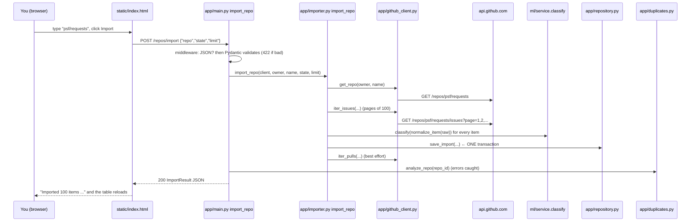

# Part 4: Understand the Complete Data Flow

[← Part 3](03_running_the_app.md) · [Index](00_INDEX.md) · Next: [Part 5: Database](05_database.md)

---

## Chapter 8: What happens when a user imports a GitHub repository?

### 8.1 The sequence



(GitHub renders Mermaid diagrams. Elsewhere, read it as numbered arrows.)

### 8.2 Step by step, with the real code

**Step 1: the user enters a repository.** `static/index.html` collects the
text, the state and the limit, then:

```javascript
const res = await postJson("/repos/import", { repo, state: $("importState").value, limit });
```

**Step 2: validation.**

1. The middleware in `app/main.py` first checks that the body is JSON
   (Chapter 30).
2. FastAPI then builds a `RepoImportRequest` (`app/schemas.py`):

   ```python
   class RepoImportRequest(BaseModel):
       repo: RepoName = Field(..., description="'owner/name' or https://github.com/owner/name")
       state: Literal["open", "closed", "all"] = "open"
       limit: int = Field(default=100, ge=1, le=500)
   ```

3. `RepoName` runs `app/github_client.py:parse_repo`. It accepts `owner/name`,
   `owner/name.git` or `https://github.com/owner/name`, applies GitHub's
   naming rules, and normalises everything to `owner/name`.
4. Anything else returns **422** before any of your code runs.

**Step 3: the route.** `app/main.py:import_repo` splits `owner/name` and gets
a `GitHubClient` through `Depends(get_github_client)`. **Dependency
injection** means FastAPI creates the client for this request and closes it
afterwards; tests replace it with a fake.

**Step 4: calling GitHub** (`app/importer.py:import_repo`).

```python
meta = client.get_repo(owner, name)                        # 1 request; private repos are refused
started_at = _github_now(client)                           # GitHub's clock, from the Date header
raw_items = list(client.iter_issues(owner, name, state=state, limit=limit))
items = [classify(normalize_item(raw)) for raw in raw_items]
```

- **Pagination.** GitHub returns at most 100 items per "page".
  `GitHubClient.iter_issues` asks for `per_page=min(100, limit)`, sorted by
  most recently updated. It then follows the `Link: <...>; rel="next"` header
  until it has `limit` items or there are no more pages.
- **Issues vs PRs.** GitHub's *issues* endpoint returns both kinds. A PR has
  an extra `pull_request` key, and `normalize_item` sets
  `"kind": "pr" if is_pr else "issue"`.
- **Turning GitHub data into our shape.** `normalize_item` keeps only the
  fields TriageBot needs: number, kind, title, body, state, author, URL,
  label names, comments, reactions, draft, dates and merge date.
- **Classifying.** `classify(...)` calls `app/ml/service.py:classify`
  (Chapter 15). That adds the category, confidence, source and reasons, plus
  priority, source and reasons.

**Step 5: saving, all or nothing.** Everything was *fetched first*. Only now
does `repository.save_import` write, inside **one database transaction**:

1. upsert the repository row;
2. upsert every item (`INSERT ... ON CONFLICT (repo_id, number) DO UPDATE`);
3. store PR merge dates;
4. record the sync point (`synced_through`).

If GitHub fails half-way (a rate limit on page 3, say), Step 5 never runs, so
**nothing is saved**. If the database fails during Step 5, the whole
transaction **rolls back**.

**Step 6: existing records.** An item is identified by
`UNIQUE (repo_id, number)`, so re-importing *updates* rows instead of
duplicating them, and `imported_at` is refreshed.

**Step 7: best-effort extras.**

- `sync_pr_list` fetches the pulls list (branches and pending review
  requests). A failure there returns a message instead of failing the
  import.
- Then `main._refresh_duplicates` runs duplicate detection. Any exception is
  logged and `duplicates` becomes `null`.

**Step 8: the response** is an `ImportResult`: `repo`, `fetched`, `issues`,
`pull_requests`, `rate_limit_remaining`, `duplicates` and `pr_metadata`. The
dashboard prints a summary and reloads the table.

**GitHub requests used by an import:** 1 (repository) + 1 per 100 items +
1 per 100 PRs (pulls list).

[VERIFIED in the final verification, 2026-10-03] Importing 60 items from
`encode/httpx` took about 2.2 s.

### Checkpoint 8

1. Why is "fetch first, write later" important?
2. How does the code tell an issue from a PR?
3. What prevents the same issue from being stored twice?

---

## Chapter 9: How repository sync works

### 9.1 Why sync is needed

An import fetches the **newest N items in one state**. Suppose you imported
with *State = Open*, and a week later issue #42 is **closed** on GitHub:

- a new `state=open` import will never list #42 again, so its local copy
  stays "open" forever;
- simply marking "every item not in the new list" as closed would be wrong,
  because it might just be beyond the limit. For a PR, "closed" would also
  wrongly suggest "not merged".

### 9.2 The idea: "what changed since T?"

- Every repository row stores **`synced_through`**: a GitHub timestamp up to
  which *all* stored items are known to be correct.
- Every change on GitHub (closing, reopening, a new comment, a label change)
  updates an item's `updated_at`.
- So asking GitHub "everything updated since T, in any state" finds every
  change.

### 9.3 Step by step (`app/importer.py:sync_repo`)

1. **Find T.** `repository.sync_window_start(repo_id)` returns
   `repos.synced_through`. For repositories imported before this column
   existed, it uses the oldest `items.imported_at`. It then subtracts
   5 minutes (`SYNC_OVERLAP`) for safety.
2. **Fetch the changes.** `GitHubClient.fetch_updated_since(owner, name,
   since=..., limit=...)` sends
   `GET /repos/{o}/{n}/issues?state=all&sort=updated&direction=asc&since=T&per_page=100`.
   - **Keyset pagination:** instead of asking for "page 2", it asks again for
     page 1 with `since` = the last `updated_at` it saw. If an item is edited
     *during* the sync, it moves to the end of the list and is picked up
     there; with page numbers it could shift another item past us.
   - A **live check** showed GitHub's `since` is *inclusive* (an item updated
     exactly at T is returned), so the boundary item is never lost.
     [VERIFIED in the code review, 2026-10-03]
3. **Keep the newest copy** of each item, then re-classify it.
4. **Save in one transaction.** `repository.save_sync` compares old and new
   states and counts:
   - **added**: not stored before;
   - **updated**: refreshed;
   - **closed**: was open, now closed;
   - **reopened**: was closed, now open.

   It then upserts the items and moves `synced_through` forward, and sets
   `last_synced_at`.
5. **Move the sync point.** If the sync is **complete**, the new point is
   GitHub's clock at the last response. If `limit` was reached, it is only the
   last applied item's `updated_at`, and `complete: false` tells you to sync
   again.
6. **Extras, best effort:** if PRs changed, the open-PR review requests are
   refreshed, and duplicate detection re-runs.

### 9.4 Failure behaviour

- Any GitHub error (rate limit, timeout, 5xx) happens *before* the write, so
  nothing changes and `synced_through` stays the same.
- The API returns 429 or 502, and the dashboard shows "Sync failed (nothing
  was changed): …".

### 9.5 Import vs sync

| | Import (`POST /repos/import`) | Sync (`POST /repos/sync`) |
|---|---|---|
| Question it answers | "Give me the newest N items in this state" | "What changed since I last looked?" |
| States fetched | Open, closed or all (you choose) | Always both |
| Order | Newest updates first | Oldest change first (keyset) |
| Size limit | 1–500 (default 100) | 1–1000 (default 500) per run |
| Repository must exist locally? | No | Yes (otherwise 404 "Repository has not been imported.") |
| Moves the sync point | Only backwards (never forward) | Forward |
| Detects closed / reopened items | Only items it happens to fetch | Yes, all of them |
| Deletes anything | No | No |
| Transaction | One | One |

### 9.6 Limitations (honest)

- Sync runs only when you press the button or call the API; there is no
  scheduler.
- Issues **deleted, transferred or made private** on GitHub are not
  reported by `since`, so they stay as last seen.
- Sync **adds** newly created items too, so the database grows beyond the
  original import limit.
- **Known bug (found in the code review).** For a repository saved *before
  migration v7* that has **no items**, `importer.sync_repo` raises a
  `ValueError` that `main.py` doesn't catch, so you get **500 Internal Server
  Error**. It's rare, and it makes a good exercise (Chapter 33, Levels 8–9).

### Checkpoint 9

1. Why can't an import move `synced_through` forward?
2. What does `complete: false` mean, and what should you do?
3. What happens to the database if GitHub returns a rate-limit error during
   a sync?

---

## Chapter 10: How API requests and responses work

### 10.1 The basics

| Term | Meaning |
|---|---|
| **API** | An agreed way for programs to talk to each other. TriageBot's API is the set of URLs in `app/main.py` |
| **HTTP** | The protocol of the web: a client sends a *request* and the server sends back a *response* |
| **Method** | What you want to do: **GET** read · **POST** create or act · **PATCH** change part of something · **DELETE** remove |
| **Endpoint** | One method + path, e.g. `GET /items` |
| **JSON** | A text format for data: `{"repo": "psf/requests", "limit": 50}` |
| **Request body** | JSON sent *to* the server (POST / PATCH) |
| **Response body** | JSON sent *back* |
| **Query parameters** | Options in the URL: `/items?priority=high&limit=5` |
| **Status code** | A 3-digit result: 2xx OK · 4xx your mistake · 5xx server problem |
| **Validation** | Checking input before using it. Pydantic models in `app/schemas.py` do it automatically |

### 10.2 Every route (from `app/main.py`)

| Method | Path | Purpose | Required | Optional | Main codes |
|---|---|---|---|---|---|
| GET | `/health` | Is the server alive? | — | — | 200 |
| GET | `/model` | ML model status and recorded scores | — | — | 200 |
| POST | `/triage` | Preview a suggestion (not saved) | `title` (1–200 characters) | `body` (≤ 5,000) | 200, 415, 422 |
| POST | `/triage/batch` | Preview up to **100** issues | a JSON list of `{title, body}` | — | 200, 415, 422 (more than 100) |
| POST | `/issues` | Triage and save a manual issue | `title` | `body` | 201, 415, 422 |
| GET | `/issues` | List manual issues, newest first | — | — | 200 |
| GET | `/issues/{id}` | One manual issue | — | — | 200, 404 |
| PATCH | `/issues/{id}` | Update; re-triages if the title or body changes | — | `title`, `body`, `status` (`open`/`closed`) | 200, 404, 422 |
| DELETE | `/issues/{id}` | Delete a manual issue | — | — | 204, 404 |
| POST | `/repos/import` | Import from GitHub | `repo` | `state` (`open`/`closed`/`all`, default `open`), `limit` (1–500, default 100) | 200, 404, 415, 422, 429, 502 |
| POST | `/repos/sync` | Sync changes | `repo` (already imported) | `limit` (1–1000, default 500) | 200, 404, 415, 422, 429, 502 (and the known 500 edge case) |
| GET | `/repos` | Imported repositories | — | — | 200 |
| GET | `/items` | Imported items | — | `repo`, `type` (`issue`/`pr`), `category`, `priority`, `state`, `source` (`ml`/`rules`/`github_label`), `q`, `limit` (1–200, default 50), `offset` | 200, 422 |
| GET | `/items/{id}/duplicates` | Possible duplicates of one item | — | — | 200, 404 |
| POST | `/duplicates/refresh` | Re-run duplicate detection | `repo` | `force` (default false) | 200, 404, 415, 422 |
| PATCH | `/duplicates/{id}` | Record a review decision | `status`: `confirmed` / `rejected` / `pending` | — | 200, 404, 415, 422 |
| GET | `/prs` | PRs with insights + summary | — | `repo`, `status`, `author`, `flag`, `size` (`XS`…`XL`/`unknown`), `min_age_days`, `max_age_days`, `q`, `sort` (`updated`/`age`/`idle`/`size`), `limit` (1–200), `offset` | 200, 422 |
| GET | `/prs/{id}` | One PR with insights | — | — | 200, 404 |
| POST | `/prs/details` | Load size and reviews (2 GitHub requests per PR) | `repo` | `limit` (1–50, default 10), `only_open` (default true), `force` | 200, 404, 415, 422, 429, 502 |
| GET | `/` | The dashboard HTML | — | — | 200 |

FastAPI also serves **`/docs`** (an interactive page) and `/openapi.json`
automatically.

### 10.3 Real examples [VERIFIED 2026-10-03, on a copy of a test database]

**Health:**

```bash
$ curl -s http://127.0.0.1:8000/health
{"status":"ok","version":"1.0.0"}
```

**Triage preview** (illustrative input; real output):

```bash
$ curl -s -X POST http://127.0.0.1:8000/triage \
    -H "Content-Type: application/json" \
    -d '{"title":"App crashes when saving a file","body":"Traceback attached"}'
```

```json
{
  "severity": "high", "labels": ["bug"], "owner": "backend-team",
  "reason": "severity=high (matched 'crash'); labels: bug ('crash'); owner=backend-team (routed by label 'bug')",
  "category": "bug", "category_confidence": "low", "category_source": "ml", "category_score": 0.5933,
  "category_reasons": ["ML model: bug (59%), runner-up question (17%)",
                       "words pointing to bug: 'crashes' (+0.65), 'crashes when' (+0.27), ..."],
  "priority": "medium", "priority_source": "rules",
  "priority_reasons": ["title mentions 'crash' (impact, +2)", "category 'bug' (+1)",
                       "total score +3 >= 3, but high needs two kinds of evidence incl. severity (found: impact) -> medium (capped)"]
}
```

Read it like this:

- `severity` / `labels` / `owner` come from the **old manual-triage engine**.
- `category*` and `priority*` come from the **ML-plus-rules pipeline**.
- `category_confidence` is `low` because the probability 0.59 is below 0.6
  (Chapter 15).

**One imported item** (a public psf/requests issue; `GET /items?repo=psf/requests&limit=1`, shortened):

```json
{"total": 100, "limit": 1, "offset": 0, "items": [{
  "id": 4, "repo": "psf/requests", "number": 6730, "kind": "issue",
  "title": "Certificate loading regression with HTTPAdapters in 2.32.3",
  "state": "closed", "comments": 5, "reactions": 17,
  "category": "bug", "category_confidence": "high", "category_source": "rules", "category_score": null,
  "category_reasons": ["rule engine used: ML was unsure (question 37% < 50% threshold)",
                       "title mentions 'regression' (+2 bug)", "...", "scores: bug=4, feature=2, documentation=0, question=0"],
  "priority": "high", "priority_source": "rules",
  "priority_reasons": ["title mentions 'regression' (impact, +2)", "category 'bug' (+1)",
                       "17 reactions (+1; supports but never sets high on its own)",
                       "total score +4 >= 3 with 2 kinds of evidence (impact, engagement) -> high"],
  "duplicate_count": 0 }]}
```

**Import** (shape only; it uses your GitHub quota):

```bash
$ curl -s -X POST http://127.0.0.1:8000/repos/import \
    -H "Content-Type: application/json" \
    -d '{"repo":"psf/requests","state":"open","limit":30}'
# → {"repo": {...}, "fetched": 30, "issues": ..., "pull_requests": ...,
#    "rate_limit_remaining": ..., "duplicates": {...}, "pr_metadata": "..."}
```

### 10.4 Error handling [VERIFIED 2026-10-03: real responses]

| Situation | Request | Status | Response `detail` |
|---|---|---|---|
| Invalid repository name | `{"repo":"not a repo"}` to `/repos/import` | **422** | `"Value error, Expected a public GitHub repository as 'owner/name' or 'https://github.com/owner/name'."` (inside a list with `loc: ["body","repo"]`) |
| Malformed JSON | body `{"title": ` | **422** | `"JSON decode error"` |
| Wrong content type | `Content-Type: text/plain` | **415** | `"Request body must be application/json."` |
| Invalid filter value | `/items?priority=urgent` | **422** | `"Input should be 'low', 'medium' or 'high'"` |
| Unknown ID | `/items/999999/duplicates` | **404** | `"Item not found"` |
| Sync of a repo not imported | `/repos/sync` | **404** | `"Repository has not been imported."` |
| Repository missing or private on GitHub | `/repos/import` | **404** | `"Repository not found (or it is private)."` |
| GitHub rate limit | import / sync / details | **429** + `Retry-After` header | "GitHub API rate limit exceeded. … Resets at HH:MM UTC." |
| GitHub down, timeout, bad token | | **502** | e.g. "GitHub did not respond in time." |
| A bug in our code | | **500** | "Internal Server Error" (details only in the server log) |

**Where this happens in the code:**

- **422:** FastAPI and Pydantic, from the types in `app/schemas.py`.
- **415:** the middleware `json_only_writes_and_security_headers` in
  `app/main.py`.
- **404:** explicit `raise HTTPException(status_code=404, ...)` in the routes.
- **429 / 502:** `app/github_client.py:GitHubClient._raise_for_status` raises
  typed errors (`RateLimitError`, `RepoNotFoundError`, `GitHubAuthError`,
  `GitHubUnavailableError`). `app/main.py:_github_http_error` maps them to
  status codes.

### Checkpoint 10

1. Which status code means "your input was wrong", and which means "GitHub
   is rate-limiting us"?
2. Which function turns GitHub errors into HTTP errors?
3. Why does sending `text/plain` get **415** rather than 422?
