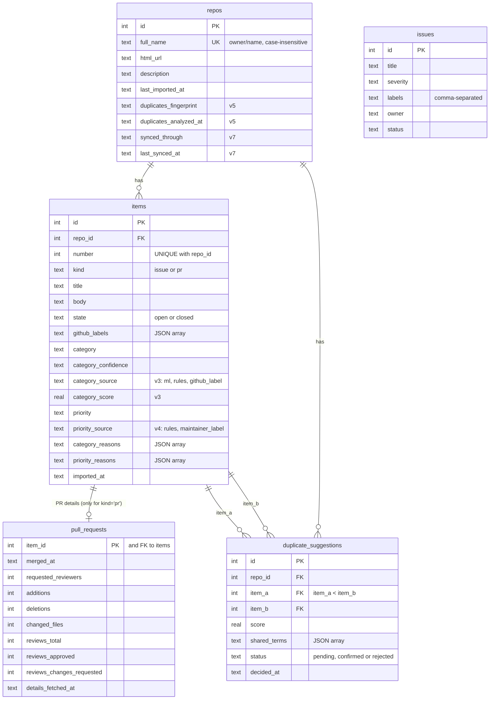

# Part 5: Understand the Database

[← Part 4](04_data_flow_and_api.md) · [Index](00_INDEX.md) · Next: [Part 6a: Classification](06_classification_and_evaluation.md)

---

## Chapter 11: SQLite and database fundamentals

### 11.1 The basic words, with TriageBot examples

| Term | Meaning | TriageBot example |
|---|---|---|
| **Database** | An organised store of data that a program can search and update | The file `triagebot.db` |
| **Relational database** | Data kept in **tables** that refer to each other | `items` rows point to their `repos` row |
| **Table** | Like a spreadsheet tab | `items` |
| **Row** | One record | Issue #6730 of psf/requests |
| **Column** | One field | `title`, `priority` |
| **Primary key** | The column that uniquely identifies a row | `items.id` |
| **Foreign key** | A column that points to another table's primary key | `items.repo_id → repos.id` |
| **Unique constraint** | A rule that stops duplicate values | `UNIQUE (repo_id, number)`: one row per issue number per repository |
| **Index** | A lookup structure that makes searches fast (like a book index) | `idx_items_filters ON items (kind, category, priority, state)` |
| **SQL** | The language for talking to a relational database | `SELECT title FROM items WHERE priority = 'high'` |
| **CRUD** | Create, Read, Update, Delete | Manual issues support all four (`/issues`) |

### 11.2 SQLite, and why this project uses it

**SQLite** is a complete database stored in **one ordinary file**, used
through Python's built-in `sqlite3` module.

**Why it fits TriageBot:**

- nothing to install or run separately;
- each test can use its own throw-away file;
- it's plenty for one user and thousands of rows.

**The trade-off:**

- only one writer at a time;
- the file lives on one machine's disk (Chapter 31).

### 11.3 Transactions, atomicity and integrity

- **A transaction** is a group of changes that succeed together or fail
  together.
  - **Analogy:** a bank transfer. Taking money out of one account and adding
    it to another must both happen, or neither.
- **Atomicity** is that "all or nothing" property.
- **Data integrity** means the data stays correct and consistent. Examples:
  - no item without a repository;
  - no half-saved import;
  - no duplicate pair stored twice.

In TriageBot, **one `with get_connection() as conn:` block is one
transaction**. Python's `sqlite3` starts a transaction automatically on the
first write. `get_connection` then commits at the end, or rolls back if
anything raised (Chapter 13).

### Checkpoint 11

1. What is the difference between a primary key and a foreign key?
2. Give one TriageBot example of a unique constraint.
3. In one sentence, what is a transaction?

---

## Chapter 12: TriageBot database design

### 12.1 Entity-relationship diagram (from the real schema)



`issues` (manual triage) is **not connected** to the other tables. It's the
original starter feature.

### 12.2 Every table

| Table | Purpose | Keys and constraints | Indexes |
|---|---|---|---|
| `issues` (v1) | Manually triaged issues | `id` PK | — |
| `repos` (v2, +v5, +v7) | Imported repositories | `id` PK; `full_name UNIQUE COLLATE NOCASE` (so `Psf/Requests` = `psf/requests`) | autoindex on `full_name` |
| `items` (v2, +v3, +v4) | Imported issues **and** PRs with their suggestions | `id` PK; `repo_id → repos(id) ON DELETE CASCADE`; `UNIQUE (repo_id, number)`; `CHECK kind IN ('issue','pr')`; `CHECK state IN ('open','closed')` | `idx_items_repo_updated (repo_id, updated_at)`, `idx_items_filters (kind, category, priority, state)` |
| `duplicate_suggestions` (v5) | Possible duplicate pairs and your decision | FKs to `repos` and `items` (cascade); `CHECK (item_a < item_b)` (each pair stored once); `UNIQUE (item_a, item_b)`; `CHECK status IN (...)` | `idx_dup_item_b`, `idx_dup_repo (repo_id, status)` |
| `pull_requests` (v6) | Extra PR data: merge date, branches, review requests, size, review counts | `item_id` is both the PK and an FK to `items` (one row per PR). **NULL means "not fetched"**, never zero | — |

**Points worth noticing:**

- **Lists are stored as JSON text** (`github_labels`, `category_reasons`, …).
  `repository._item_row_to_dict` turns them back into Python lists.
- **`ON DELETE CASCADE`** means "deleting a repository deletes its items",
  but the API has **no** "delete repository" endpoint.
- **Foreign keys** are only enforced because every connection runs
  `PRAGMA foreign_keys = ON` (`app/database.py:get_connection`).

### 12.3 How one issue is stored and read back

1. The importer builds a dictionary such as
   `{"number": 6730, "kind": "issue", "title": "...", "github_labels": [],
   "category": "bug", "category_reasons": [...], ...}`.
2. `repository._upsert_items` converts the lists to JSON text and runs:

   ```sql
   INSERT INTO items (repo_id, number, kind, title, ...) VALUES (?, ?, ?, ?, ...)
   ON CONFLICT (repo_id, number) DO UPDATE SET title = excluded.title, ..., imported_at = datetime('now')
   ```

   The `?` placeholders mean values are sent **separately from the SQL
   text**. That prevents SQL injection (Chapter 30).
3. `GET /items` calls `repository.list_items`. It builds a `WHERE` clause
   only from a **fixed list** of allowed filter columns (`_ITEM_FILTERS`). It
   sorts by `CASE priority WHEN 'high' THEN 0 ...`, then `updated_at DESC`,
   and adds a sub-query that counts non-rejected duplicate suggestions
   (`duplicate_count`).

### Checkpoint 12

1. Why does `duplicate_suggestions` have `CHECK (item_a < item_b)`?
2. What does NULL mean in `pull_requests.reviews_total`?
3. Which code prevents an unknown filter name from being put into SQL?

---

## Chapter 13: Database initialisation and migrations

### 13.1 Why migrations exist

- **The problem:** the code changes over time and needs new tables and
  columns. Your existing `triagebot.db` still has the *old* structure.
  Deleting it would lose your data.
- **The solution:** a **migration** is a numbered, one-time upgrade script.
  The database remembers which number it's at: its **schema version**.

TriageBot stores the version in SQLite's built-in header field
**`PRAGMA user_version`**, an integer that starts at 0.

### 13.2 The actual migration list (`app/database.py:MIGRATIONS`)

| Version | Change |
|---|---|
| 1 | `CREATE TABLE IF NOT EXISTS issues` (the starter table) |
| 2 | `repos`, `items`, two indexes |
| 3 | `items.category_source`, `items.category_score` (ML) |
| 4 | `items.priority_source` (`'rules'` default, correct for old rows) |
| 5 | `duplicate_suggestions` + 2 indexes; `repos.duplicates_fingerprint`, `repos.duplicates_analyzed_at` |
| 6 | `pull_requests` |
| 7 | `repos.synced_through`, `repos.last_synced_at` (sync) |

The rule written in the code: **"Never edit a released migration; append a
new one instead."**

### 13.3 How `init_db()` works (simplified, but true to the code)

```python
conn = sqlite3.connect(path, timeout=BUSY_TIMEOUT, isolation_level=None)  # we control transactions
_enable_wal(conn)                                  # write-ahead logging (retries if "locked")
for version, sql in MIGRATIONS:
    conn.execute("BEGIN IMMEDIATE")                # take the write lock NOW
    if conn.execute("PRAGMA user_version").fetchone()[0] >= version:
        conn.execute("ROLLBACK")                   # already applied (maybe by another process)
        continue
    for statement in _statements(sql):             # split the script into statements
        conn.execute(statement)
    conn.execute(f"PRAGMA user_version = {version}")
    conn.execute("COMMIT")                         # schema change + version bump together
    # (on any exception: ROLLBACK, then re-raise)
```

**A worked example.** An old database is at version 5:

| Migration | What happens |
|---|---|
| v1–v5 | `BEGIN IMMEDIATE` → the version is 5, which is ≥ the migration → `ROLLBACK` → skip |
| v6 | `BEGIN IMMEDIATE` → 5 < 6 → `CREATE TABLE pull_requests …` → `user_version = 6` → `COMMIT` |
| v7 | The same: two `ALTER TABLE`s → `user_version = 7` → `COMMIT` |

If v7 failed half-way, `ROLLBACK` would undo it, and the database would stay
a valid v6.

A **fresh** database starts at version 0, so all seven migrations run in
order.

### 13.4 The concurrency bug that was fixed

- **Old code:** it read `user_version` once, *outside* any transaction, then
  ran each migration with `executescript("BEGIN; ...; COMMIT;")`.
- **What went wrong:** with `uvicorn --workers 4`, all four processes read
  "0" at the same moment and all tried `CREATE TABLE repos`. Three crashed
  with "table repos already exists".
  [REPORTED: reproduced 10/10 with the old code during Phase 6.]
- **The fix:**
  - `BEGIN IMMEDIATE` lets only one process hold the write lock at a time;
  - the version is re-checked *inside* the lock;
  - the script is split with `sqlite3.complete_statement` (`_statements`),
    because `executescript` would commit on its own and break the
    transaction.
- **The test:** `tests/test_database.py::test_concurrent_init_db_applies_each_migration_once`
  starts 4 threads at once.

**WAL mode and the busy timeout:**

- **WAL** (write-ahead log) lets readers keep reading while one connection
  writes.
- Switching to WAL needs an exclusive lock, and SQLite answers "database is
  locked" *immediately* if another process holds one. So `_enable_wal`
  retries for up to 15 s. This fixed a flaky test.
- `BUSY_TIMEOUT = 15.0` makes ordinary writers wait up to 15 s for a lock
  instead of failing at once.

### 13.5 Transactions during normal requests

```python
@contextmanager
def get_connection():
    conn = sqlite3.connect(_db_path(), timeout=BUSY_TIMEOUT)
    conn.row_factory = sqlite3.Row
    conn.execute("PRAGMA foreign_keys = ON")
    try:
        yield conn
        conn.commit()        # block finished → save
    except BaseException:
        conn.rollback()      # anything raised → undo
        raise
    finally:
        conn.close()
```

Functions that do a lot inside one block, and are therefore atomic:

- `save_import`: repository + items + PR merge dates + sync point;
- `save_sync`: items + PR merge dates + new sync point;
- `save_duplicate_analysis`: deletes *pending* pairs, upserts new ones,
  keeps reviewed ones, updates the fingerprint.

`tests/test_sync.py::test_failed_database_write_rolls_back_the_whole_import`
forces a failure and checks that no repository row is left behind.

### 13.6 Inspecting and backing up the database safely

**⚠ Before experimenting, back up.** These commands only read the original
file, but always keep a copy before trying anything new.

```bash
# 1. Backup (safe even while the server runs; creates a NEW file)   [CHANGES STATE: new file]
$ sqlite3 triagebot.db ".backup 'triagebot-backup.db'"

# 2. Inspect the COPY, not the live file
$ sqlite3 triagebot-backup.db "PRAGMA user_version;"            # → 7
$ sqlite3 triagebot-backup.db "PRAGMA integrity_check;"         # → ok
$ sqlite3 triagebot-backup.db ".tables"
$ sqlite3 triagebot-backup.db ".schema items"
$ sqlite3 triagebot-backup.db "SELECT number, state, category, priority FROM items LIMIT 5;"
```

[VERIFIED 2026-10-03 on a scratch database] `.backup` produced a valid copy
(`integrity_check` = `ok`).

**Notes:**

- Run dot-commands (`.tables`, `.schema`) on their own. Mixing them with SQL
  in one quoted string gives a syntax error.
- `sqlite3 -readonly` on a WAL-mode **copy** fails with "unable to open
  database file", because it can't create the `-shm` side file. Open the
  copy normally instead.

**Destructive operations** (avoid on real data):

- `DELETE`, `DROP`, `UPDATE` typed by hand;
- deleting `triagebot.db` (or its `-wal` file while the server runs);
- `DELETE /issues/{id}` (removes one manual issue).

There is **no** API to delete imported data. For experiments, use
`TRIAGEBOT_DB=/tmp/play.db`.

### Checkpoint 13

1. Where is the schema version stored?
2. Why does each migration begin with `BEGIN IMMEDIATE` and re-check the
   version?
3. How do you back up the database before an experiment?
